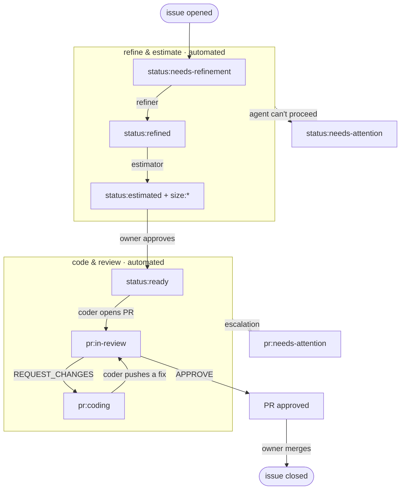

# interns

[](https://github.com/abi83/interns/actions/workflows/ci.yml)
[](https://github.com/abi83/interns/actions/workflows/ci.yml)

A tireless team of interns that refine issues, estimate them, open PRs, and review each other's work — with a human in
the loop when really needed.

The pipeline drives [Claude Code](https://github.com/anthropics/claude-code) over a
checked-out repo, respects its `CLAUDE.md` / `AGENTS.md`, and runs entirely in the
host repo's GitHub Actions — no hosted service, no VMs to manage, no machine of your
own left running. Each issue and PR is its own workflow run, so the work fans out
concurrently and scales with your Actions runners, not with your attention.

Status: early.
Design and roadmap: [#3](https://github.com/abi83/interns/issues/3).

## What it does

Four agents pick issues up by label and hand them along a fixed track:

| Agent | Trigger                                                               | Does | Leaves |
|---|-----------------------------------------------------------------------|---|---|
| **Refiner** | `status:needs-refinement` on an issue                                 | picks the type, checks the draft against the codebase and wiki, rewrites the body into the type's template (and the title if it no longer fits), posts a blockers/dependencies comment | `status:refined` |
| **Estimator** | `status:refined`                                                      | reads the code the Scope touches, scores blast radius / touch / human involvement / review overhead; the pipeline maps those four scores to a size | `status:estimated` + `size:*` |
| **Coder** | `status:ready` (human-assigned) on a `type:coding-task` or `type:bug` | implements every Acceptance Criteria item, writes tests, opens a PR that `Closes #N` | `status:in-progress`, a PR labelled `pr:in-review` |
| **Reviewer** | a PR opened/updated by the coder (or a human)                         | waits for the PR's checks to be green, reviews the diff against the linked issue, submits `APPROVE` or `REQUEST_CHANGES` | PR approved, or a coder fix round, or `pr:needs-attention` |

Agents never call the GitHub API directly: every read and write — issue
lookups, label changes, comments, reviews — goes through an MCP server that
validates the request first. Agents have no tool that writes an arbitrary
label: lifecycle labels (`status:*`, `pr:*`, `size:*`) change only through a
phase's outcome tool, and the refiner's one other label write is limited to
`type:*`. So a misfiring agent can't step outside the label state machine or
touch a protected path. Whatever can be decided
without judgment — creating a branch, checking whether tests pass, rolling
up an estimate to a size, appending metrics — runs as plain scripted logic
around the agent instead of burning its tokens on a deterministic task.

The human owner steps in twice. First, on a refined and estimated issue: decide
whether to run the automated implementation flow, or send the task back for
rework — e.g. the scope is too broad to land in one PR, the estimator flagged a
huge blast radius, or refinement surfaced blockers and missing prerequisites.
Approving is a single move: the label `status:estimated` → `status:ready` —
or skip it for sizes you trust the pipeline with, via `auto_proceed` (see
[Pipeline configuration](#pipeline-configuration)).
Second, give the finished PR — already implemented and reviewer-approved — a
final look and merge it. Everything in between is automated, and
anything the automation can't finish — a Claude error, a vague issue
description, missing prerequisites or blockers — is parked on
`status:needs-attention` / `pr:needs-attention` for a human to pick up.



## Label state machine

The installer syncs these from the versioned manifest
([`.github/labels.json`](.github/labels.json)). Label sync is additive — labels
not in the manifest are left alone.

### `status:*` — issue lifecycle (mutually exclusive)

| Label | Meaning                                                | Set by                                                                      | Moves to                                                                                                                                                                       |
|---|--------------------------------------------------------|-----------------------------------------------------------------------------|--------------------------------------------------------------------------------------------------------------------------------------------------------------------------------|
| `status:needs-refinement` | awaiting the refiner                                   | **human**, triggers the refinement-estimation pipeline                      | `status:refined`, or `status:needs-attention` if the refiner needs a decision                                                                                                  |
| `status:refined` | refined, awaiting estimation                           | refiner                                                                     | `status:estimated` (+ `size:*`); `status:needs-attention` if unsizeable                                                                                                       |
| `status:estimated` | estimated — waiting on the owner to approve or comment | estimator                                                                   | `status:ready` set by a human (or by the pipeline when `auto_proceed` enables the size) to trigger the coder, or a human **comment** to trigger conversational follow-up (TBD, [#11](https://github.com/abi83/interns/issues/11)). |
| `status:ready` | approved for the coder                                 | **human** (or the pipeline, per `auto_proceed`), triggers the coder-reviewer pipeline                             | `status:in-progress` when the coder starts; `status:needs-attention` if the issue isn't a `type:coding-task` / `type:bug`                                                      |
| `status:in-progress` | a coder-reviewer loop is in progress                   | coder                                                                       | cleared when the PR merges (issue closed by `Closes #N`); `status:needs-attention` if the PR is closed unmerged, or on any pipeline stall                                        |
| `status:needs-attention` | pipeline stalled — a human needs to look               | any agent                                                                   | cleared when a human re-dispatches (the coder drops it on pickup)                                                                                                              |

### `pr:*` — PR pipeline (mutually exclusive)

Once the coder opens a PR the work enters the **coder–reviewer loop**: the
reviewer holds `pr:in-review`, and on `REQUEST_CHANGES` it hands back to the
coder as `pr:coding`; the coder pushes a fix and hands back as `pr:in-review`.
Two limits bound the loop:

- **One automatic fix round.** The coder gets a single fix attempt. If the
  reviewer's *second* review still requests changes, the PR goes to
  `pr:needs-attention` — the automatic loop didn't converge.
- **Five reviewer runs per PR, hard.** A backstop for after escalation: a human
  can keep pushing commits and each one still spawns a reviewer run. At 5 total
  reviews on the PR, automatic review stops entirely and stays manual.

A red PR check also sends the PR straight to `pr:needs-attention`, with no fix
round. The linked issue keeps its status.

| Label | Meaning                                      | Set by                      | Moves to |
|---|----------------------------------------------|-----------------------------|---|
| `pr:coding` | a coder agent is on this PR (e.g. fix round) | reviewer, when it requests changes | `pr:in-review` after the coder pushes |
| `pr:in-review` | a reviewer agent is on this PR               | coder, at hand-off          | cleared on `APPROVE`; `pr:coding` on `REQUEST_CHANGES`; `pr:needs-attention` on escalation |
| `pr:needs-attention` | PR pipeline stalled — a human needs to look  | reviewer gate               | cleared by the next agent run, once a human re-triggers the flow or pushes a commit |

#### PR-loop transitions

The full event → outcome table and diagram are generated from code; see
[docs/architecture.md](docs/architecture.md#pr-loop-transitions).


An approved PR carries **no** `pr:*` label — the native review state is the
signal. List the PRs waiting on a human with
`gh pr list --label pr:needs-attention`.

### `type:*` — set by the refiner (or a human at creation), never changed after

| Label | Estimated? | Coder implements? |
|---|---|---|
| `type:coding-task` | yes | yes |
| `type:bug` | yes | yes |
| `type:spike` | yes | no — a human does the investigation |
| `type:epic` | no — refiner rejects epic-sized issues to `status:needs-attention` | no — a human breaks it into sub-issues |

Spikes and epics are never implemented automatically. A spike's pipeline path
**ends at `status:estimated`** — the estimate exists so the owner can judge
whether the investigation is worth their time; they then do the work and close
the issue. There is no spike greenlight: `status:ready` is coder-only, so moving
a spike there is a mistake, and the coder's type gate bounces it to
`status:needs-attention`. An epic doesn't get refined at all — the refiner
rejects epic-sized issues to `status:needs-attention` and a human breaks them
into sub-issues. Either way, a human takes it from there.

### `size:*` and `priority:*`

`size:XS` … `size:XL` are applied alongside `status:estimated`: the estimator
scores the four criteria and a fixed lookup table maps that tuple to one size,
so the size is reproducible from the scores.
`priority:low` …
`priority:urgent` are owner triage labels — the pipeline reads neither; they
exist for humans sorting the backlog.

## Setup

From a local clone, with the GitHub CLI authenticated as a repo admin:

```bash
curl -LsSf https://raw.githubusercontent.com/abi83/interns/v0/install.sh | sh
```

Full guide, including the GitHub Apps, secrets and the install PR you merge: [docs/install.md](docs/install.md).

### Pipeline configuration

Interns' defaults live in one file,
[`templates/config/defaults.yml`](templates/config/defaults.yml). `interns-install`
renders your `.github/interns.yml` from it with every key **commented out**, so
you can see what's configurable and at what value without pinning a snapshot
of it. Uncomment a key only to
override it deliberately; everything else follows interns' defaults as they
change. A value can only come from your file or those defaults — there is no
second, overlapping source.

The reviewer needs **all** of a PR's checks to be green before it runs — a
red or cancelled check on anything routes the PR to a human instead. It is
triggered when any workflow of the repo completes (`workflow_run: completed`
for all workflows in the caller; the pipeline's own is ignored), so no runner
sits idle polling CI; checks still running after the short
`checks.timeout_seconds` wait just skip that run, and the next workflow to
complete triggers the review again. (`check_suite` is no use here: GitHub does
not deliver it for suites created by Actions.) Name any
non-blocking advisory checks (preview deploys, coverage deltas) under
`checks.ignore` in `.github/interns.yml` to keep them out of that gate.
Gate timing (`checks.timeout_seconds` / `poll_seconds` / `settle_seconds`)
and the coder–reviewer loop caps (`review_loop.max_fix_rounds` /
`max_automatic_reviews`) are documented with their defaults in the config
file.

`agents.reviewer.trigger` narrows which PR events start a review: `coder_prs`
and `human_prs` select whose PRs are reviewed, and `rereview_on_push: false`
reviews only when a PR is opened or marked ready. All default to `true`, and a
manual `workflow_dispatch` (`phase: reviewer`) always runs. Fork PRs and other
bots' PRs are never reviewed.

`auto_proceed` decides, per size label, whether an estimated
`type:coding-task` / `type:bug` goes straight to the coder without waiting for
your `status:estimated` → `status:ready` approval. By default `XS`, `S` and `M`
proceed; `L` and `XL` wait for you. Override single sizes in
`.github/interns.yml` — the rest keep their defaults:

```yaml
auto_proceed:
  L: true
```

#### Agent tools

interns gives each agent a fixed tool set. Extend it with `allowed_tools` and
narrow it with `disallowed_tools` (examples in the config file); both work in
`defaults` and per agent, and the lists add up. A deny always wins, including
over interns' own tools.

**A wildcard like `Bash(npm run *)` is effectively arbitrary code execution
via package scripts.** Keep patterns narrow and put them under the one agent
that needs them: `defaults` applies to every agent.

#### Wiki

With `wiki.enabled`, the wiki is checked out next to the repo (`../<name>.wiki`) and every agent can read it.

### Makefile targets

The coder runs in a fresh runner, so the consumer repo's
[`Makefile`](templates/config/Makefile) is the language-agnostic contract:

- `setup` — install dependencies. The pipeline runs `make setup` before the
  coder starts, in both the initial and fix rounds; a non-zero exit fails the
  job before any Claude tokens are spent.
- `test` / `build` — run by the coder before pushing, and by the reviewer.

Each target ships as a stub containing `INTERNS: not configured`. A stubbed (or
absent) `setup` is skipped with a warning; fill in the real command to enable
it. `interns-install` appends the `setup` stub to an existing `Makefile` that
lacks the target.


## Operating

What starts a run, where you step in, how to re-run a phase and what to do when something stalls: [docs/operate.md](docs/operate.md).

## Pipeline metrics

Every agent run is recorded to a branch in your repo and charted on a dashboard: see [docs/metrics.md](docs/metrics.md).

## Code layout

Python under `interns/src/interns`, with imports flowing one way
(enforced by `tests/guards/test_layers.py`):

`gh.transport` → `gh.ops` → `domain` → `steps` / `gh_issues_mcp/server.py` / `entrypoint`

- `gh/` — the only code that talks to `gh`; `transport` is private to `gh`.
- `domain/` — shared logic and read models (`labels`, `issues`, `push`,
  `verdict`, `size`, `build_config`, `checks`, `routing`). Imports nothing from
  `steps`, `entrypoint` or `mcp`. `routing` is the pipeline's entry edge: it
  parses the triggering event and maps it to the one job it starts.
- `steps/` — one module per workflow command, a thin wrapper over `domain/`.
  Every command's `main` lives here, with no exceptions (guarded by
  `tests/guards/test_command_locations.py`). A step module never shares a
  basename with a `domain/` module (e.g. `edit_labels` wraps `domain.labels`,
  `query_verdict` wraps `domain.verdict`, `show_config` wraps `config`). A step
  never imports another step.
- Top-level `config.py`, `execution.py`, `cli.py`, `ctx.py` — shared library
  modules, not commands.
- `entrypoint.py` — the one command entry (`python3 -m interns.entrypoint <command>`):
  builds `ActionsCtx` and dispatches to the steps, with a single missing-env
  error path. Commands take `(ctx, argv)` and build their parser with
  `cli.build_parser(<command>)`. Exception: `check-build-config`, `config`,
  `prompt`, `resolve-issue-template` and `run-setup` take `(argv)` only, because
  their workflow steps carry no GitHub token or repository env for the ctx.
- `gh_issues_mcp/server.py` — the agent-facing MCP tools, built on `domain/`.

Each reusable workflow starts with a `plan` job: `route-event` / `confirm-route`
decide which job the event starts (and whether its gates pass), and every other
job gates only on `needs.plan.outputs.job`. The workflow YAML keeps the
`on:` triggers and a coarse filter on `plan`.

`confirm-route` also guards who may start an agent job (`domain/actor_guard.py`),
before any other gate. Every actor listed must be a user with write or admin
access (resolved through the collaborator permission API) or a pipeline identity:
`github-actions[bot]` or an `interns-{coder,reviewer,triage}-*` App. Anything else
is refused with `actor refused: ...` and no job starts; an actor whose permission
cannot be resolved fails the step.

| Event | Starts | Actors checked |
|---|---|---|
| `issues: labeled` | refine, estimate, coder | sender |
| `workflow_dispatch` | refine, estimate, coder (incl. fix round), reviewer | sender |
| `workflow_run` | reviewer | sender, upstream run's actor and triggering actor |
| `pull_request` opened / ready / synchronize | reviewer | sender |
| `pull_request` closed | PR cleanup, no agent | none |

## License

MIT
