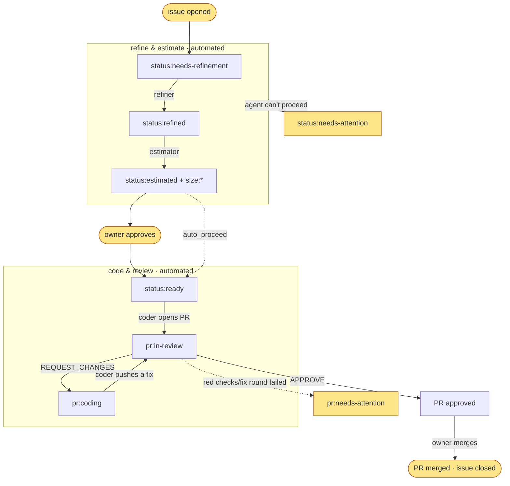

# interns

[](https://github.com/abi83/interns/actions/workflows/ci.yml)
[](https://github.com/abi83/interns/actions/workflows/ci.yml)

A tireless team of interns that refine issues, estimate them, open PRs, and review each other's work — with a human in
the loop when really needed.

The pipeline drives [Claude Code](https://github.com/anthropics/claude-code) over a
checked-out repo, respects its `CLAUDE.md` / `AGENTS.md`, and runs entirely in the
host repo's GitHub Actions — no hosted service, no VMs to manage, no machine of your
own left running. Each issue and PR is its own workflow run, so the work fans out
concurrently and scales with your Actions runners, not with your attention.

Status: early. Design: [docs/architecture.md](docs/architecture.md).

## What it does

Four agents pick issues up by label and hand them along a fixed track:

| Agent | Trigger                                                               | Does | Leaves |
|---|-----------------------------------------------------------------------|---|---|
| **Refiner** | `status:needs-refinement` on an issue                                 | picks the type, checks the draft against the codebase and wiki, rewrites the body into the type's template (and the title if it no longer fits), posts a blockers/dependencies comment | `status:refined` |
| **Estimator** | `status:refined`                                                      | reads the code the Scope touches, scores blast radius / touch / human involvement / review overhead; the pipeline maps those four scores to a size | `status:estimated` + `size:*` |
| **Coder** | `status:ready` (human-assigned) on a `type:coding-task` or `type:bug` | implements every Acceptance Criteria item, writes tests, opens a PR that `Closes #N` | `status:in-progress`, a PR labelled `pr:in-review` |
| **Reviewer** | a PR opened/updated by the coder (or a human)                         | waits for the PR's checks to be green, reviews the diff against the linked issue, submits `APPROVE` or `REQUEST_CHANGES` | PR approved, or a coder fix round, or `pr:needs-attention` |

Interns work on rails. They never touch GitHub directly: every move goes through a
MCP server gatekeeper that checks it first, so a confused intern can't wander off the track, and
anything that needs no judgment (branches, test runs, sizing, metrics) is plain and strict code, not
tokens. Per intern scoped `GITHUB_TOKEN` just adds some guards on top, rhough this is still LLMs and I suggest to keep eyes open, as "LLM can make mistakes"

You stay the boss, and you're called in twice: to green-light a refined, estimated issue
(one label flip, configurable with [`auto_proceed`](docs/configuration.md)), and to give the
finished, reviewed PR a final look before merging. Whenever the interns get stuck, they
stop and flag you rather than guess.



Amber marks where a human acts: opening the issue, approving, merging, and picking up
anything the interns flagged.

## Quickstart

From a local repository clone, with the GitHub CLI authenticated as a repo admin:

```bash
curl -LsSf https://raw.githubusercontent.com/abi83/interns/v0/install.sh | sh
```

## Docs

| Doc | Answers |
|---|---|
| [docs/install.md](docs/install.md) | How do I set it up (GitHub Apps, secrets, the install PR)? |
| [docs/configuration.md](docs/configuration.md) | What can I tune (defaults, reviewer gate, agent tools, wiki, Makefile contract)? |
| [docs/operate.md](docs/operate.md) | What starts a run, how do I re-run a phase, what do I do when something stalls? |
| [docs/metrics.md](docs/metrics.md) | Where do run metrics go and how are they charted? |
| [docs/architecture.md](docs/architecture.md) | Why is it built this way: trust model, layers, invariants, label state machine, how to extend it? |
| [docs/test-guide.md](docs/test-guide.md) | How do I write a test here? |

## License

MIT
