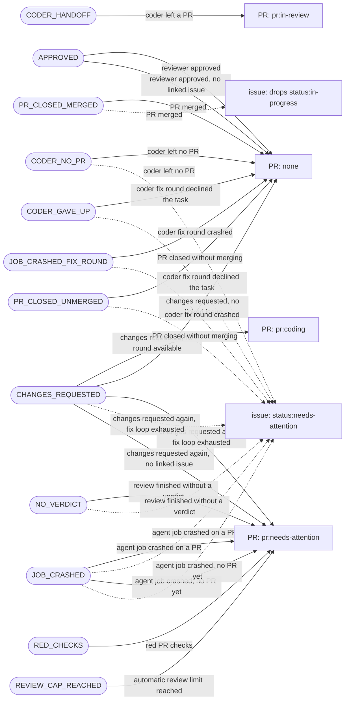

# Architecture

Why interns is built the way it is, the invariants that keep it safe, and where to
change things. Read this before changing the pipeline.

## Intent

Agents do the judgment work (refine, estimate, code, review); everything
deterministic is plain code around them. Three decisions follow:

- **Agent writes to GitHub go through MCP.** Comments, labels, reviews, PRs and pushes use
  the server in [`gh_issues_mcp/server.py`](../gh_issues_mcp/server.py), which validates
  each request. No tool writes an arbitrary label, so an agent cannot leave the state
  machine. Agents have no `git push`, and the only direct `gh` access is read-only
  (the reviewer's `gh pr diff/view/checks`, `gh run view`). The boundary is the tool
  allowlist, not credential isolation: `GH_TOKEN` is in the agent's environment, so a broad
  `Bash(gh *)` added via `allowed_tools` would bypass it.
- **Labels are the state machine.** An issue's or PR's labels say where it is; a label
  event is what starts the next job. No external database.
- **Scripted logic around agents.** Branching, check gating, size roll-up, metrics and
  routing run as Python steps, not as agent tokens.

Everything runs in the consumer repo's GitHub Actions: no hosted service.

## Layers

Imports flow one way, enforced by [`tests/guards/test_layers.py`](../tests/guards/test_layers.py):

`gh.transport` → `gh.ops` → `domain` → `steps` / `gh_issues_mcp/server.py` / `entrypoint`

| Layer | Role |
|---|---|
| `interns/src/interns/gh/` | the only code that calls `gh` |
| `domain/` | pure logic and read models: labels, lifecycle, routing, verdicts, sizes |
| `steps/` | one module per workflow command, a thin wrapper over `domain/`; steps never import each other |
| `entrypoint.py` | `python3 -m interns.entrypoint <command>`: builds the context, dispatches to a step |

Each reusable workflow ([`issue-pipeline.yml`](../.github/workflows/issue-pipeline.yml),
[`code-pipeline.yml`](../.github/workflows/code-pipeline.yml)) starts with a `plan` job:
`route-event` and `confirm-route` pick the one job the event starts, and every other job
gates only on `needs.plan.outputs.job`. `confirm-route` also checks who triggered the
event ([`domain/actor_guard.py`](../interns/src/interns/domain/actor_guard.py)): write
access or a pipeline identity, anything else is refused.

## Invariants

- **Fail fast.** Invalid state raises. The only exception is `best_effort.call` with a
  non-empty reason (guarded by `test_no_swallowed_errors.py`).
- **Label edits are best-effort**, a missed one is re-set by a later run. Everything
  else is strict.
- **Protected paths** (workflows, CI config) cannot be pushed by the coder:
  [`domain/push.py`](../interns/src/interns/domain/push.py).
- **Each phase gets only its own MCP tools**, and the exposed set must equal the allowed
  set (`test_mcp_tool_exposure.py`, `test_*_tool_allowlist.py`).
- **Spikes and epics are never coded.** The type gate bounces them to
  `status:needs-attention`.

## Label state machine

The full set is [`.github/labels.json`](../.github/labels.json); constants live in
[`domain/labels.py`](../interns/src/interns/domain/labels.py).

Issue lifecycle, `status:*` (one at a time):

| Label | Set by | Next |
|---|---|---|
| `status:needs-refinement` | human | `refined` (refiner) |
| `status:refined` | refiner | `estimated` + `size:*` (estimator) |
| `status:estimated` | estimator | `ready`: a human, or the pipeline per `auto_proceed` |
| `status:ready` | human / `auto_proceed` | `in-progress` (coder picks up) |
| `status:in-progress` | coder | cleared when the PR merges |
| `status:needs-attention` | any phase that stalls | cleared when a human re-triggers |

PR loop, `pr:*` (one at a time; an approved PR carries none, the review state is the signal):

| Label | Set by | Next |
|---|---|---|
| `pr:in-review` | coder, at hand-off | cleared on `APPROVE`; `pr:coding` on `REQUEST_CHANGES` |
| `pr:coding` | reviewer, on `REQUEST_CHANGES` | `pr:in-review` after the coder's fix |
| `pr:needs-attention` | reviewer gate | cleared when a human re-triggers or pushes |

Loop limits: one automatic fix round (a second `REQUEST_CHANGES` escalates) and five
automatic reviews per PR; red checks escalate with no fix round. Limits are configured
in [`templates/config/defaults.yml`](../templates/config/defaults.yml).

`type:*` is set by the refiner and never changed. `size:*` comes from the estimator's
four scores via a fixed lookup ([`domain/size.py`](../interns/src/interns/domain/size.py)).
`priority:*` is for humans; the pipeline ignores it.

### PR-loop transitions

Every PR-loop step fires one event through `domain.lifecycle.decide`. The block below is
generated from it; regenerate with
`PYTHONPATH=interns/src uv run --frozen python -m interns.domain.lifecycle_docs`.
`tests/guards/test_lifecycle.py` fails on drift.

<!-- lifecycle:start -->
| Event | Situation | PR label | Issue | Comment | Dispatch |
|---|---|---|---|---|---|
| `CODER_HANDOFF` | coder left a PR | `pr:in-review` | unchanged | none | none |
| `CODER_NO_PR` | coder left no PR | none | `status:needs-attention` | CODER_NO_PR on the issue | none |
| `CODER_GAVE_UP` | coder fix round declined the task | none | `status:needs-attention` | CODER_GAVE_UP on the issue | none |
| `APPROVED` | reviewer approved | none | unchanged | APPROVED on the issue | none |
| `APPROVED` | reviewer approved, no linked issue | none | unchanged | none | none |
| `CHANGES_REQUESTED` | changes requested, fix round available | `pr:coding` | unchanged | none | coder fix round |
| `CHANGES_REQUESTED` | changes requested, no linked issue | none | unchanged | CHANGES_REQUESTED_NO_ISSUE on the PR | none |
| `CHANGES_REQUESTED` | changes requested again, fix loop exhausted | `pr:needs-attention` | `status:needs-attention` | FIX_LOOP_EXHAUSTED on the PR | none |
| `CHANGES_REQUESTED` | changes requested again, no linked issue | `pr:needs-attention` | unchanged | FIX_LOOP_EXHAUSTED on the PR | none |
| `NO_VERDICT` | review finished without a verdict | `pr:needs-attention` | `status:needs-attention` | NO_VERDICT on the PR | none |
| `RED_CHECKS` | red PR checks | `pr:needs-attention` | unchanged | RED_CHECKS on the PR | none |
| `REVIEW_CAP_REACHED` | automatic review limit reached | `pr:needs-attention` | unchanged | REVIEW_CAP_REACHED on the PR | none |
| `JOB_CRASHED` | agent job crashed on a PR | `pr:needs-attention` | `status:needs-attention` | JOB_FAILED on the PR | none |
| `JOB_CRASHED` | agent job crashed, no PR yet | `pr:needs-attention` | `status:needs-attention` | JOB_FAILED on the issue | none |
| `JOB_CRASHED_FIX_ROUND` | coder fix round crashed | none | `status:needs-attention` | FIX_ROUND_FAILED on the issue | none |
| `PR_CLOSED_MERGED` | PR merged | none | drops `status:in-progress` | none | none |
| `PR_CLOSED_UNMERGED` | PR closed without merging | none | `status:needs-attention` | PR_CLOSED_UNMERGED on the issue | none |

<!-- lifecycle:end -->

## Agent tools

Agents get Claude Code's built-in read tools (`Read`, `Grep`, `Glob`; the coder adds
edit and shell tools) plus the `gh-issues` MCP tools, exposed per phase through
`INTERNS_MCP_TOOLS`. Source of truth: `@_tool` functions in
[`server.py`](../gh_issues_mcp/server.py).

| Category | Tools |
|---|---|
| Read issues | `list_issues`, `view_issue` |
| Write issues | `comment_issue`, `edit_issue`, `set_issue_type` |
| Pull requests | `open_pr`, `comment_pr`, `submit_pr_review` |
| Git | `push_branch` (squashes to one commit, refuses protected paths) |
| Phase outcomes | `apply_refinement_outcome`, `apply_estimation_outcome` |

Users extend or narrow the built-in set with `allowed_tools` / `disallowed_tools` in
`.github/interns.yml`.

## How to change things

**Add a workflow step.** Put logic in `domain/`, a thin `main(ctx, argv)` in
`steps/<name>.py` (no basename shared with a `domain/` module), register it in
`entrypoint.py`, call it from the workflow. Guards in `tests/guards/` check the
conventions.

**Add a label.** Add it to `.github/labels.json` and `domain/labels.py`. If it takes part
in the PR loop, add a scenario to `domain/lifecycle.py`, then regenerate the block above.

**Add an MCP tool.** Add an `@_tool` function in `server.py`, list it in the phase's
`tools:` and `AGENT_ALLOWED_TOOLS` in the workflow, and mention it in the phase prompt
under `.github/prompts/`.

**Add a config key.** Add it, commented out, to `templates/config/defaults.yml` and to
`.github/interns.schema.json`; read it through `config.py`.

Tests: [test-guide.md](test-guide.md).
